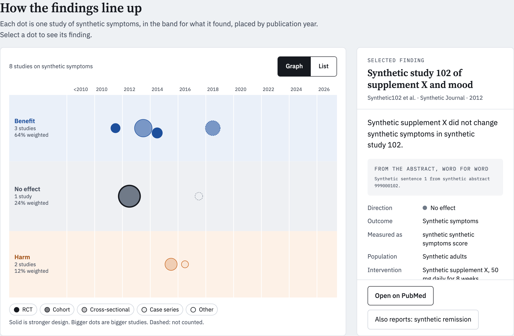

# Claimgraph

Ask "does vitamin D affect depression?" and you meet hundreds of studies that seem to disagree.
Claimgraph reads their PubMed abstracts, extracts each finding with the sentence it came from,
groups findings that measure the same outcome, and names the likely reason when two studies
disagree: different people, a different dose or comparator, a different measure, or a weaker
design. A static page shows the result.

Research navigation demo, not medical advice.



**Status:** the pipeline runs end to end on one question, vitamin D and depression, and the
hosted page shows its run: every kept abstract extracted, the outcome mapping reviewed, and the
top candidate pairs of each outcome classified by a three-vendor council. Extraction, outcome
normalization and contradiction classification are each scored against hand labels, and the
scores below are generated from committed recordings. Creatine and cognition runs from the CLI.

## At a glance

- **What the page shows.** One tab per outcome. Each has a strip counting studies by
  direction, weighted by design; a graph or list of every finding; the selected finding with
  its claim beside the verbatim sentence; the contradictions, grouped by likely reason, with
  the ones that dissolve on a close read in a collapsed list; and a page per pair setting the
  two findings side by side. Reviews are listed, not counted, and a method section says what
  was retrieved, kept and dropped.
- **How well it works.** [Results](#results) scores each model step against hand labels:
  extraction field by field, the outcome mapping's merge precision and recall, and each
  classification arm's accuracy and cost per pair. Every figure there is generated from
  committed recordings, never typed.
- **What it costs.** [Cost](#cost) gives the measured spend per stage and per run, read from
  the run manifests.
- **How to run it.** After `uv sync`, `uv run pytest` runs every test from recorded model
  responses, with no API key and no network. [Run it](#run-it) has the rest.

## How it works

1. **Retrieve** abstracts for a fixed PubMed query: any exposure term and any outcome term in the
   title or abstract, or the matching MeSH headings (scope `title_abstract`), added to PubMed
   through a fixed date, excluding non-research items and animal-only studies.
2. **Extract** findings on the question's outcomes with a model; every quote must match its
   abstract word for word.
3. **Normalize** outcome names through a mapping a model proposes and a person reviews.
4. **Compare** only findings on the same outcome that point different ways, one headline
   finding per study, so pairs grow with studies, not findings.
5. **Classify** each pair as genuine, apparent or off the question, with the likely reason.
   The arms range from one small-model answer to a council of Claude, OpenAI and Google
   models; the evals below compare them.
6. **Build** one JSON export per question, which the page reads and nothing else.

Runs replay recorded model responses by default, so the pipeline and its tests run without an
API key. Live model calls are opt-in with `--live`, and a `--dry-run` estimates their cost
first. See [DESIGN.md](DESIGN.md) for the decisions behind each step.

## Run it

None of these calls a model or needs an API key; the evals replay committed recordings:

```
uv sync
uv run pytest                                             # every test
uv run claimgraph eval extraction vitamin-d-depression    # extraction scores
uv run claimgraph eval normalization vitamin-d-depression # outcome mapping scores
npm --prefix site ci
npm --prefix site run dev                                 # the page on /?fixture=synthetic
uv run claimgraph export fetch                            # the real export, checked against
                                                          # its pinned hash; needs gh signed in
```

The real export is a public release asset, so `gh` is only a convenience: without it, download
the asset that `site/export.lock.json` names from the repository's `exports` release into
`site/public/export.json`, and check that its SHA-256 matches the lock's. The dev server then
shows the real page on `/`.

A run of your own starts with retrieval, which needs a contact email for NCBI:

```
cp .env.example .env    # add a contact email for NCBI
uv run --env-file .env claimgraph run vitamin-d-depression --stage retrieve
uv run claimgraph run vitamin-d-depression --stage extract --dry-run
```

Retrieval writes `runs/vitamin-d-depression/`: the cached PubMed records, the parsed abstracts
and a manifest of what was found, kept and dropped. A rerun reads the cache and makes no
requests. Every later stage has a dry run that prices it before anything is sent, and
`uv run claimgraph --help` lists the commands.

## Results

Every table here is generated from the evals' output. The extraction eval runs on 32
hand-labeled abstracts, so its intervals are wide; [DESIGN.md](DESIGN.md#evals) gives the
width.

**Label consistency.** Gold records with findings, drawn at random, were labeled a second
time, blind to the first pass. Outcomes agree when they name the same measure. Generated by
`claimgraph gold agreement vitamin-d-depression --readme README.md`.

<!-- gold-agreement:start -->
Second labeling pass over 5 gold records. Findings: 7 in the first pass, 6 in the second, 6 matched on quote.

| Field | Agreement |
|---|---|
| design | 5 of 5 |
| sample_size | 5 of 5 |
| outcome_reported | 5 of 6 |
| effect | 6 of 6 |
| is_primary | 6 of 6 |
| is_subgroup | 6 of 6 |
| baseline_vitamin_d_status | 5 of 6 |
<!-- gold-agreement:end -->

**Extraction.** The extraction prompt scored against the gold labels, field by field, from the
responses committed in `replay/`. Findings are matched to the labels on their quote; precision
is over the model's findings and recall over the labeled ones. Generated by
`claimgraph eval extraction vitamin-d-depression --readme README.md`.

<!-- extraction-eval:start -->
Extraction by claude-sonnet-5-5 on 32 gold abstracts, scored from the committed recordings; 0 invalid after the retry.

| Study field | Correct |
|---|---|
| design, review tags first and the answers otherwise | 31 of 32 (97%) |
| design, every design tag first | 30 of 32 (94%) |
| design, from the model's answers alone | 31 of 32 (97%) |
| sample size | 27 of 32 (84%) |

| Finding field | Precision | Recall |
|---|---|---|
| finding, matched on quote | 25 of 33 (76%) | 25 of 33 (76%) |
| outcome_reported | 21 of 33 (64%) | 21 of 33 (64%) |
| effect | 24 of 33 (73%) | 24 of 33 (73%) |
| is_primary | 25 of 33 (76%) | 25 of 33 (76%) |
| is_subgroup | 24 of 33 (73%) | 24 of 33 (73%) |
| baseline_vitamin_d_status | 20 of 33 (61%) | 20 of 33 (61%) |

Quotes verbatim on the first output: 33 of 33 (100%); 0 dropped. Off-topic abstracts with no findings: 4 of 4 (100%). Design other: 1 of 32.
<!-- extraction-eval:end -->

**Run to run.** The API takes no sampling parameters, so two live runs of the same requests can
differ. A second Sonnet 5.5 run over the gold set, recorded in `replay/second-run/`, compared
with the first. Generated by `claimgraph eval extraction vitamin-d-depression --second-run
replay/second-run --readme README.md`.

<!-- extraction-rerun:start -->
Second live run over 32 gold records. Findings: 33 in the first run, 32 in the second, 30 matched on quote.

| Field | Agreement |
|---|---|
| design | 32 of 32 |
| sample_size | 31 of 32 |
| outcome_reported | 28 of 30 |
| effect | 30 of 30 |
| is_primary | 30 of 30 |
| is_subgroup | 30 of 30 |
| baseline_vitamin_d_status | 30 of 30 |
<!-- extraction-rerun:end -->

**Model choice.** Each model on the same gold abstracts and the same prompt. Extraction runs on
Sonnet 5.5, chosen on design; [DESIGN.md](DESIGN.md#gold-runs) gives the reasoning. Generated by
`claimgraph eval models vitamin-d-depression --second-run replay/second-run --readme
README.md`.

<!-- extraction-models:start -->
Each model on the same gold abstracts and prompt, scored from the committed recordings; cost of the recorded responses at batch prices.

| Model | Design, review tags first | Design, every design tag first | Design, answers alone | Sample size | Finding precision | Finding recall | Effect precision | Effect recall | Cost |
|---|---|---|---|---|---|---|---|---|---|
| claude-haiku-5-5 | 27 of 32 | 26 of 32 | 27 of 32 | 28 of 32 | 26 of 38 | 26 of 33 | 25 of 38 | 25 of 33 | $0.0082 |
| claude-haiku-5-5, second run | 27 of 32 | 26 of 32 | 27 of 32 | 27 of 32 | 22 of 39 | 22 of 33 | 21 of 39 | 21 of 33 | $0.0084 |
| claude-sonnet-5-5 | 31 of 32 | 30 of 32 | 31 of 32 | 27 of 32 | 25 of 33 | 25 of 33 | 24 of 33 | 24 of 33 | $0.1341 |
| claude-sonnet-5-5, second run | 31 of 32 | 30 of 32 | 31 of 32 | 27 of 32 | 26 of 32 | 26 of 33 | 25 of 32 | 25 of 33 | $0.1305 |
<!-- extraction-models:end -->

**Normalization.** Each outcome proposal scored against the outcome kinds, one label per
string, from the proposals committed in `replay/`. Two strings should merge exactly when they
share a kind, so precision is over the pairs a proposal merges and recall over the pairs the
labels merge. Generated by `claimgraph eval normalization vitamin-d-depression --readme
README.md`.

<!-- normalization-eval:start -->
Outcome proposals by claude-sonnet-5-5 on the 547 outcome strings, scored from the committed recordings over every pair of in-domain strings and over the 167 drawn pairs that are in the domain. In sample: the outcome rules were written while labeling these same strings, so the rules prompt's rates are not held-out estimates. A correction found only where a proposal disagreed can raise its score but never lower it, so each proposal is shown before and after those.

| Proposal | Labels | Scored pairs | Merge precision | Merge recall | Drawn precision | Drawn recall |
| --- | --- | ---: | ---: | ---: | ---: | ---: |
| First proposal | Before the 17 corrections its disagreements found | 127,260 | 88.0% | 88.2% | 83.1% | 79.6% |
| First proposal | All 23 corrections | 125,751 | 93.5% | 94.1% | 86.5% | 89.5% |
| Rules prompt, frozen | Before the 3 corrections its disagreements found | 127,260 | 97.6% | 92.1% | 97.5% | 90.7% |
| Rules prompt, frozen | All 23 corrections | 125,751 | 97.6% | 92.7% | 97.5% | 90.7% |

The frozen prompt's proposal, against all corrections, by stratum of the draw; the strata come from the first proposal.

| Stratum | Pool | Drawn | Out of domain | Scored | Labeled merges | Proposed merges | Both | Merge precision | Merge recall |
| --- | ---: | ---: | ---: | ---: | ---: | ---: | ---: | ---: | ---: |
| named | 10 | 10 | 0 | 10 | 4 | 4 | 4 | 100.0% | 100.0% |
| cut off vs score | 1,249 | 10 | 0 | 10 | 2 | 2 | 2 | 100.0% | 100.0% |
| cut off vs case | 4,184 | 10 | 3 | 7 | 7 | 7 | 7 | 100.0% | 100.0% |
| incidence vs severity | 15,857 | 10 | 1 | 9 | 0 | 0 | 0 | n/a | n/a |
| general vs scale | 13,023 | 10 | 2 | 8 | 3 | 3 | 3 | 100.0% | 100.0% |
| grouped | 61,070 | 75 | 6 | 69 | 62 | 62 | 61 | 98.4% | 98.4% |
| split related | 1,041 | 75 | 21 | 54 | 8 | 2 | 1 | 50.0% | 12.5% |
| split unrelated | 52,897 | 0 | 0 | 0 | 0 | 0 | 0 | n/a | n/a |

547 strings, 45 labeled out of domain and left out of every pair. The proposal has 7 outcomes and put 51 strings outside the domain, 41 of them labeled out of domain.
<!-- normalization-eval:end -->

**Contradictions.** Every classification arm on the drawn eval pairs, scored against hand
labels as pre-registered in [DESIGN.md](DESIGN.md#evals) before any arm saw them, with the
cost per pair of each arm. The question it answers: does deliberation between models beat
the best single model at the same token budget? Generated by `claimgraph eval contradictions
vitamin-d-depression --readme README.md`, which replays the arms' recorded answers and needs
the run's extraction.

<!-- contradiction-eval:start -->
Six arms on the 300 eval pairs, scored from the committed recordings against 70 hand labels: the drawn disagreement pairs, weighted by the inverse of their chance of being drawn, and the first agreement pairs, weighted for the rest. 10 labeled pairs are off the question and left out, so the figures cover an estimated 233 pairs on it. Precision on genuine and verdict accuracy judge the verdict alone. Reason accuracy, strict, needs the verdict and the label's primary reason exactly; lenient also accepts a reason the label lists under also_differs. Strict rates are low because the labeled pairs are the hardest ones, the disagreements, weighted up to stand for their strata, and an exact reason match is required. 95% intervals from 10,000 bootstrap rounds.

| Arm | Precision on genuine | Verdict | Reason, strict | Reason, lenient | Called off question | Cost per pair | Billed tokens per pair |
| --- | ---: | ---: | ---: | ---: | ---: | ---: | ---: |
| single-small | 76.1% (70% to 80%) | 73.6% (67% to 79%) | 43.3% (27% to 58%) | 45.1% (29% to 60%) | 92 | $0.0001 | 3,476 |
| single-mid | 83.1% (78% to 88%) | 84.8% (79% to 89%) | 44.2% (28% to 59%) | 51.4% (35% to 66%) | 85 | $0.0016 | 3,469 |
| self-consistency | 81.4% (76% to 86%) | 82.1% (77% to 87%) | 47.0% (31% to 62%) | 55.2% (39% to 70%) | 87 | $0.0094 | 20,807 |
| self-moa | 89.1% (84% to 94%) | 89.2% (84% to 94%) | 47.0% (31% to 62%) | 52.3% (36% to 67%) | 89 | $0.0069 | 14,582 |
| council | 93.3% (89% to 97%) | 93.8% (90% to 97%) | 54.2% (38% to 69%) | 59.6% (43% to 74%) | 85 | $0.0075 | 12,069 |
| council-ranked | 88.8% (84% to 93%) | 88.8% (84% to 93%) | 52.5% (36% to 67%) | 58.7% (43% to 73%) | 87 | $0.0152 | 20,995 |

Paired differences in reason accuracy, strict, in points: against single-small and against council, the best arm.

| Arm | Against single-small | Against council |
| --- | ---: | ---: |
| single-small | — | -11.0 (-16.3 to -5.5) |
| single-mid | +1.0 (-3.5 to +5.5) | -10.0 (-15.3 to -4.6) |
| self-consistency | +3.8 (-1.7 to +9.4) | -7.2 (-11.9 to -2.5) |
| self-moa | +3.8 (-2.6 to +10.2) | -7.2 (-12.5 to -1.8) |
| council | +11.0 (+5.5 to +16.3) | — |
| council-ranked | +9.2 (+4.4 to +14.0) | -1.8 (-4.4 to +0.0) |

Scope rule: the best arm is council, +11.0 (+5.5 to +16.3) points over single-small, so the most alike pairs are classified at council, the cheapest arm whose interval against the best includes zero.

Reason accuracy before and after the 5 corrections made after scoring. Each applied a written rule on a pair where every arm agreed, so it moves every arm alike and no paired difference.

| Arm | Strict, before | Strict, after | Lenient, before | Lenient, after |
| --- | ---: | ---: | ---: | ---: |
| single-small | 22.3% | 43.3% | 24.1% | 45.1% |
| single-mid | 23.2% | 44.2% | 30.4% | 51.4% |
| self-consistency | 26.0% | 47.0% | 34.2% | 55.2% |
| self-moa | 26.0% | 47.0% | 31.3% | 52.3% |
| council | 33.2% | 54.2% | 38.6% | 59.6% |
| council-ranked | 31.5% | 52.5% | 37.7% | 58.7% |

<details><summary>Reasons by arm, and accuracy by stratum</summary>

Estimated pairs on the question, by the label's reason (rows) and the arm's (columns).

**single-small**

| Label | comparator | design_or_bias | intervention | off_question | outcome_measure | population |
| --- | ---: | ---: | ---: | ---: | ---: | ---: |
| comparator | 0 | 0 | 0 | 0 | 0 | 10 |
| design_or_bias | 0 | 79 | 0 | 3 | 2 | 21 |
| intervention | 2 | 36 | 4 | 6 | 0 | 2 |
| outcome_measure | 0 | 24 | 0 | 0 | 2 | 0 |
| population | 0 | 2 | 2 | 0 | 2 | 26 |
| unclear | 0 | 0 | 0 | 0 | 10 | 0 |

**single-mid**

| Label | comparator | design_or_bias | intervention | off_question | outcome_measure | population |
| --- | ---: | ---: | ---: | ---: | ---: | ---: |
| comparator | 0 | 0 | 0 | 0 | 0 | 10 |
| design_or_bias | 0 | 69 | 0 | 0 | 9 | 27 |
| intervention | 2 | 32 | 0 | 0 | 0 | 17 |
| outcome_measure | 0 | 22 | 2 | 0 | 2 | 0 |
| population | 0 | 0 | 0 | 0 | 0 | 32 |
| unclear | 0 | 0 | 0 | 0 | 10 | 0 |

**self-consistency**

| Label | comparator | design_or_bias | intervention | off_question | outcome_measure | population |
| --- | ---: | ---: | ---: | ---: | ---: | ---: |
| comparator | 0 | 0 | 0 | 0 | 0 | 10 |
| design_or_bias | 0 | 73 | 0 | 0 | 7 | 25 |
| intervention | 2 | 29 | 2 | 0 | 0 | 17 |
| outcome_measure | 0 | 19 | 2 | 0 | 4 | 0 |
| population | 0 | 0 | 0 | 0 | 2 | 30 |
| unclear | 0 | 0 | 0 | 0 | 10 | 0 |

**self-moa**

| Label | comparator | design_or_bias | intervention | off_question | outcome_measure | population |
| --- | ---: | ---: | ---: | ---: | ---: | ---: |
| comparator | 0 | 0 | 0 | 0 | 0 | 10 |
| design_or_bias | 0 | 73 | 0 | 0 | 22 | 10 |
| intervention | 2 | 36 | 0 | 0 | 0 | 12 |
| outcome_measure | 0 | 13 | 2 | 0 | 11 | 0 |
| population | 2 | 0 | 0 | 2 | 2 | 26 |
| unclear | 0 | 0 | 0 | 0 | 10 | 0 |

**council**

| Label | comparator | design_or_bias | intervention | off_question | outcome_measure | population |
| --- | ---: | ---: | ---: | ---: | ---: | ---: |
| comparator | 0 | 0 | 0 | 0 | 0 | 10 |
| design_or_bias | 0 | 75 | 0 | 0 | 16 | 15 |
| intervention | 2 | 38 | 4 | 0 | 0 | 6 |
| outcome_measure | 0 | 0 | 2 | 0 | 24 | 0 |
| population | 2 | 0 | 4 | 0 | 2 | 24 |
| unclear | 0 | 0 | 0 | 0 | 10 | 0 |

**council-ranked**

| Label | comparator | design_or_bias | intervention | off_question | outcome_measure | population |
| --- | ---: | ---: | ---: | ---: | ---: | ---: |
| comparator | 0 | 0 | 0 | 0 | 0 | 10 |
| design_or_bias | 0 | 71 | 0 | 0 | 11 | 24 |
| intervention | 2 | 36 | 4 | 0 | 0 | 8 |
| outcome_measure | 0 | 0 | 2 | 0 | 24 | 0 |
| population | 2 | 0 | 2 | 2 | 2 | 24 |
| unclear | 0 | 0 | 0 | 0 | 10 | 0 |

Correct, strict, by stratum of the draw; point estimates only, from few labels.

| Stratum | Pairs | Labeled | Scored | single-small | single-mid | self-consistency | self-moa | council | council-ranked |
| --- | ---: | ---: | ---: | ---: | ---: | ---: | ---: | ---: | ---: |
| Depression cases, benefit_vs_harm, observational_observational | 40 | 15 | 15 | 0.0% | 0.0% | 13.3% | 13.3% | 20.0% | 6.7% |
| Depression cases, benefit_vs_harm, trial_observational | 1 | 1 | 1 | 0.0% | 0.0% | 0.0% | 0.0% | 0.0% | 0.0% |
| Depression cases, benefit_vs_harm, with_other | 2 | 0 | 0 | n/a | n/a | n/a | n/a | n/a | n/a |
| Depression cases, effect_vs_none, observational_observational | 33 | 7 | 7 | 9.2% | 9.2% | 9.2% | 9.2% | 18.3% | 18.3% |
| Depression cases, effect_vs_none, trial_observational | 33 | 4 | 0 | n/a | n/a | n/a | n/a | n/a | n/a |
| Depression cases, effect_vs_none, trial_trial | 1 | 0 | 0 | n/a | n/a | n/a | n/a | n/a | n/a |
| Depression cases, effect_vs_none, with_other | 17 | 2 | 2 | 50.0% | 50.0% | 50.0% | 50.0% | 50.0% | 50.0% |
| Depressive symptoms, benefit_vs_harm, observational_observational | 41 | 10 | 9 | 0.0% | 11.1% | 11.1% | 33.3% | 100.0% | 100.0% |
| Depressive symptoms, benefit_vs_harm, trial_observational | 16 | 3 | 2 | 0.0% | 0.0% | 50.0% | 100.0% | 100.0% | 100.0% |
| Depressive symptoms, effect_vs_none, observational_observational | 33 | 6 | 6 | 76.4% | 84.3% | 92.1% | 76.4% | 84.3% | 84.3% |
| Depressive symptoms, effect_vs_none, trial_observational | 33 | 8 | 7 | 36.5% | 36.5% | 36.5% | 36.5% | 36.5% | 36.5% |
| Depressive symptoms, effect_vs_none, trial_trial | 33 | 9 | 7 | 57.1% | 42.9% | 28.6% | 14.3% | 0.0% | 0.0% |
| Depressive symptoms, effect_vs_none, with_other | 17 | 5 | 4 | 100.0% | 100.0% | 100.0% | 100.0% | 100.0% | 100.0% |

</details>

**Post-hoc check, not pre-registered:** the same figures without the 29 eval pairs drawn before the 15D polarity override. Those pairs test whether an arm catches a polarity error, read then as harm against a benefit, that the corpus no longer has. 58 labels remain, 9 of them off the question, covering an estimated 207 pairs.

| Arm | Precision on genuine | Verdict | Reason, strict | Reason, lenient | Called off question | Cost per pair | Billed tokens per pair |
| --- | ---: | ---: | ---: | ---: | ---: | ---: | ---: |
| single-small | 84.1% (79% to 88%) | 80.5% (74% to 85%) | 47.9% (30% to 64%) | 50.0% (32% to 66%) | 89 | $0.0001 | 3,476 |
| single-mid | 87.4% (83% to 91%) | 88.0% (84% to 92%) | 48.0% (30% to 64%) | 56.0% (38% to 72%) | 83 | $0.0016 | 3,469 |
| self-consistency | 88.2% (84% to 92%) | 88.0% (83% to 92%) | 50.0% (32% to 66%) | 59.2% (42% to 75%) | 84 | $0.0094 | 20,807 |
| self-moa | 95.3% (91% to 99%) | 93.9% (89% to 98%) | 46.8% (29% to 63%) | 52.8% (35% to 69%) | 86 | $0.0069 | 14,582 |
| council | 93.2% (89% to 97%) | 93.0% (88% to 97%) | 48.9% (31% to 65%) | 54.9% (37% to 71%) | 83 | $0.0075 | 12,069 |
| council-ranked | 88.6% (84% to 93%) | 87.4% (82% to 92%) | 46.9% (29% to 63%) | 53.9% (36% to 70%) | 85 | $0.0152 | 20,995 |

Paired differences in reason accuracy, strict, in points: against single-small and against self-consistency, the best arm.

| Arm | Against single-small | Against self-consistency |
| --- | ---: | ---: |
| single-small | — | -2.1 (-8.1 to +3.1) |
| single-mid | +0.1 (-4.8 to +5.0) | -2.1 (-6.1 to +1.1) |
| self-consistency | +2.1 (-3.1 to +8.1) | — |
| self-moa | -1.1 (-7.1 to +5.2) | -3.2 (-7.3 to +0.9) |
| council | +0.9 (-4.4 to +6.9) | -1.2 (-6.2 to +3.8) |
| council-ranked | -1.1 (-6.2 to +4.2) | -3.2 (-7.3 to +0.9) |

Scope rule: the best arm is self-consistency, and its gain over single-small, +2.1 (-3.1 to +8.1) points, has an interval that includes zero, so every candidate pair is classified at single-small.

**Ruling:** the two figures pick different arms, council on the pre-registered figure and single-small without those pairs. The pre-registered figure picks it only because of the 15D pairs, a data error the corpus no longer has, and without them no arm separates from single-small. So the owner ruled: single-small for every pair, unless its precision on genuine without those pairs is clearly below council's. Without those pairs, single-small's precision on genuine is 84.1% (79% to 88%) and council's 93.2% (89% to 97%); the intervals do not overlap.

The hosted page classifies the pairs whose studies are most alike at council, and shows the closely matched ones, alike in every field the comparison checks. The accuracy above is measured on the stratified 300 eval pairs, drawn to stand for every candidate pair; the page's pairs are chosen differently, so its mix of verdicts and reasons need not match the eval's.
<!-- contradiction-eval:end -->

## A second question

Creatine and cognition runs on the same code with its own config, from the CLI only, with no
hosted page. The table sets it beside vitamin D and depression.

<!-- question-contrast:start -->
|  | `vitamin-d-depression` | `creatine-cognition` |
| --- | ---: | ---: |
| Question | Does vitamin D affect depression? | Does creatine supplementation affect cognition? |
| Abstracts kept | 1,901 | 188 |
| Studies with a headline finding | 422 | 34 |
| Findings extracted | 815 | 83 |
| Outcomes | 4 | 15 |
| Candidate pairs | 24,324 | 60 |
| Outcome mapping | reviewed | unreviewed |
| Extraction, measured | $5.26 | $0.51 |
| `single-small`, estimated | $5.11 (at most $34.58) | $0.012 (at most $0.085) |
| `single-small`, measured | $2.33 (from 40 dev pairs) | n/a |
| `single-mid`, estimated | $102.24 (at most $691.64) | $0.25 (at most $1.70) |
| `single-mid`, measured | $40.04 (from 40 dev pairs) | n/a |
| `self-consistency` (k = 6), estimated | $576.27 (at most $4,163.08) | $1.39 (at most $10.21) |
| `self-moa`, estimated | $396.79 (at most $2,800.60) | $0.96 (at most $6.87) |
| `council`, estimated | $639.51 (at most $2,799.56) | $1.56 (at most $6.87) |
| `council`, measured | $193.77 (from 201 corpus pairs) | n/a |
| `council-ranked`, estimated | $1,183.80 (at most $4,906.93) | $2.89 (at most $12.04) |
| `council-ranked`, measured | $388.20 (from 40 dev pairs) | n/a |

Each depth's estimate is the classify dry run's for every candidate pair, as if none were recorded: typical output and no cache reads at batch prices, with the most it could cost in brackets. A measured row scales a current run's spend per pair, cache reads included, to every candidate pair. Prices checked 2026-11-16.

Unreviewed outcome mapping: `creatine-cognition`. Some of its outcomes, polarity overrides or exclusions are the model's or the reviewer's proposal, not yet confirmed, so its counts can change; the CLI demo runs on it, and the hosted build refuses it.
<!-- question-contrast:end -->

## Cost

What each recorded run of the vitamin D question spent, read from its run manifests and
recordings and priced by the dated `prices.toml`. Gold-set extraction is priced in the model
table above. Generated by `claimgraph costs vitamin-d-depression --readme README.md`.

<!-- run-costs:start -->
Measured spend of each recorded run, from the token counts the API returned and the price file of the date shown. Extraction and classification go through batches and are priced at batch rates; the outcome proposal is one direct request, priced at standard rates. Retrieval calls no model. A run counts every response it recorded, replayed ones included.

| Stage | Run | Models | Requests | Input | Cache writes | Cache reads | Output | Cost | Prices of |
| --- | --- | --- | ---: | ---: | ---: | ---: | ---: | ---: | --- |
| retrieve | last retrieval | PubMed E-utilities | 0 | 0 | 0 | 0 | 0 | $0.0000 | free |
| extract | corpus-first200-sonnet | claude-sonnet-5-5 | 200 | 147,185 | 7,153 | 1,423,447 | 74,818 | $0.6014 | 2026-11-13 |
| extract | corpus-sonnet | claude-sonnet-5-5 | 1,903 | 1,291,701 | 14,306 | 13,597,853 | 654,751 | $5.2632 | 2026-11-13 |
| extract | dev-haiku | claude-haiku-5-5 | 50 | 33,951 | 7,153 | 350,497 | 35,659 | $0.0128 | 2026-11-13 |
| normalize | sonnet proposal 60df41ed | claude-sonnet-5-5 | 1 | 11,157 | 0 | 0 | 12,900 | $0.1513 | 2026-11-16 |
| normalize | sonnet proposal 67f6f870 | claude-sonnet-5-5 | 1 | 12,547 | 0 | 0 | 11,040 | $0.1355 | 2026-11-16 |
| classify | corpus-council | claude-sonnet-5-5, gemini-4-argon, gpt-6.1-sol | 1,756 | 1,818,850 | 188,588 | 3,056,023 | 265,961 | $3.5372 | 2026-11-16 |
| classify | dev-council-ranked | claude-sonnet-5-5, gemini-4-argon, gpt-6.1-sol | 283 | 313,987 | 55,606 | 430,128 | 46,675 | $0.6384 | 2026-11-16 |
| classify | dev-single-mid | claude-sonnet-5-5 | 40 | 24,390 | 2,697 | 105,183 | 6,565 | $0.0658 | 2026-11-16 |
| classify | dev-single-mid.round1 | claude-sonnet-5-5 | 40 | 24,390 | 2,015 | 78,585 | 7,202 | $0.0668 | 2026-11-16 |
| classify | dev-single-small | claude-haiku-5-5 | 40 | 24,390 | 2,697 | 105,183 | 7,688 | $0.0038 | 2026-11-16 |
| classify | dev-single-small.round1 | claude-haiku-5-5 | 40 | 24,390 | 2,015 | 78,585 | 7,924 | $0.0037 | 2026-11-16 |
| classify | eval-council-ranked | claude-sonnet-5-5, gemini-4-argon, gpt-6.1-sol | 2,115 | 2,336,670 | 262,381 | 3,353,293 | 346,026 | $4.5624 | 2026-11-16 |
| classify | eval-council | claude-sonnet-5-5, gemini-4-argon, gpt-6.1-sol | 1,200 | 1,230,579 | 59,766 | 2,163,985 | 166,473 | $2.2459 | 2026-11-16 |
| classify | eval-self-consistency | claude-sonnet-5-5 | 1,800 | 1,089,606 | 0 | 4,854,600 | 297,962 | $2.8221 | 2026-11-16 |
| classify | eval-self-moa | claude-sonnet-5-5 | 1,200 | 905,525 | 5,499 | 3,262,401 | 201,167 | $2.0814 | 2026-11-16 |
| classify | eval-single-mid | claude-sonnet-5-5 | 300 | 181,601 | 5,394 | 803,706 | 49,853 | $0.4778 | 2026-11-16 |
| classify | eval-single-small | claude-haiku-5-5 | 300 | 181,601 | 2,697 | 806,403 | 52,206 | $0.0263 | 2026-11-16 |

| Stage | Runs | Cost |
| --- | ---: | ---: |
| retrieve | 1 | $0.0000 |
| extract | 3 | $5.2760 |
| normalize | 2 | $0.2868 |
| classify | 12 | $16.5317 |
| All stages | 18 | $22.0946 |

corpus-first200-sonnet's recordings are corpus-sonnet's, so the totals count them once.
<!-- run-costs:end -->

## Tradeoffs and known failure modes

Abstracts only, one question at a time, and a human-reviewed outcome mapping: cheaper and more
checkable than full text, at the cost of what abstracts leave out. The failure modes the evals
track are listed in [DESIGN.md](DESIGN.md#failure-modes).

Known limitation: retracted papers are excluded using the retraction status in each cached
record, which is only as current as the last fetch. Published runs refresh the cache first.

Known limitation: papers on the same trial or dataset can be paired as a contradiction, since
they match on everything the most-alike selection compares. Papers that share a trial
registration are merged into one study first, but an unregistered trial or a shared survey is
not. Of the 201 classified pairs, none shares a named trial and 3 share a survey: Zhao 2010
against Huang 2025, Guo 2025 and Chen 2025, all on NHANES, from different cycles and so
different people. Found by string matching; see DESIGN.md. The merge also misses a trial whose
registration only one paper names: Libuda 2020 and Schlarbaum 2026 appear to report the same
adolescent trial (DRKS00009758), and stay two studies, both no clear difference.

Known limitation: "No clear difference" mostly means the abstract reported no significant difference, so
the summary strip maps what studies reported rather than synthesizing them. Cochrane's handbook
(chapter 12, section 12.2.2.1) rejects vote counting by statistical significance, because small
studies that cannot detect a real effect get counted as showing none.

Known limitation: on a phone, Graph view sets some dots so close that a neighbour's tap area
covers part of one. List view, the default under 720px, reaches every study, as do the arrow
keys in Graph view, so the page relies on WCAG 2.2's equivalent-control exception to the target
size minimum (success criterion 2.5.8).

Known limitation: the classify dry run's estimate runs high. For the council run on the most
alike pairs it estimated $5.75, and the run measured $1.74, about a third of it. The measured
rows in the comparison above scale real spend, and are the better guide.

## Outcomes

Placeholder until a real reader has used the page.

## Licence

Code: MIT. Gold-set abstracts: their original CC BY/CC0 licences; see
[ATTRIBUTION](evals/gold/vitamin-d-depression/ATTRIBUTION.md). Quotes on the page come from
PubMed abstracts and remain under their publishers' terms, so the page's export is published as
a release asset and never committed.
